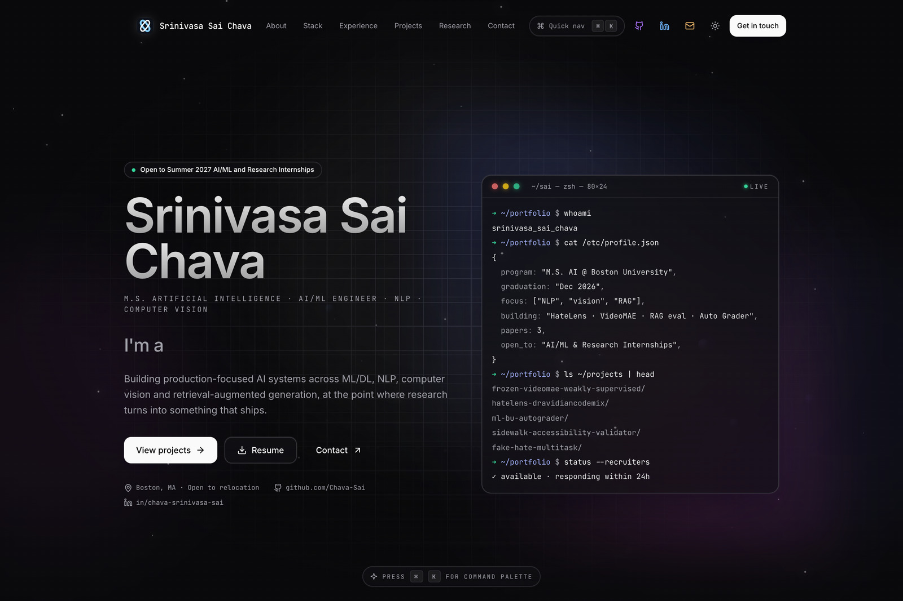
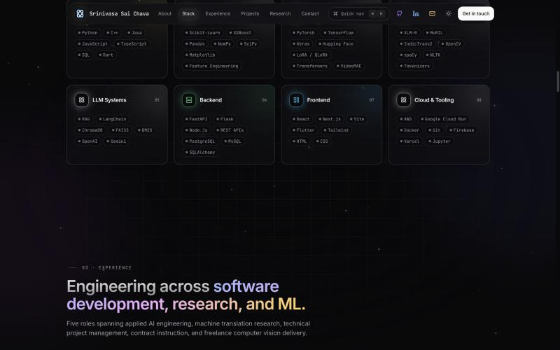
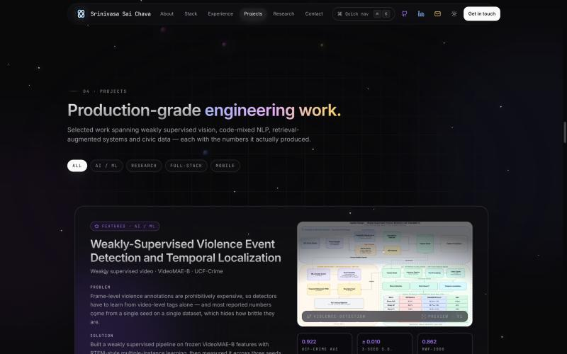
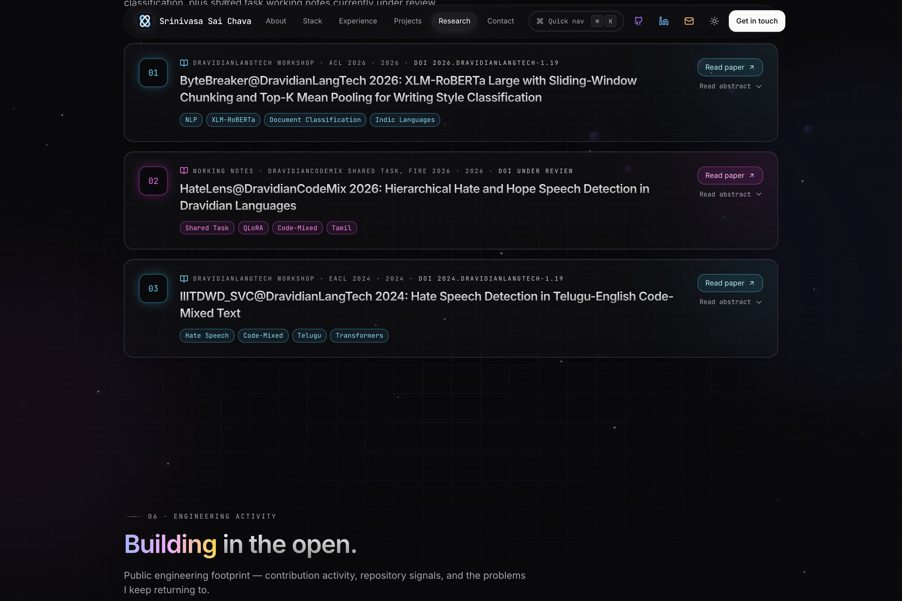

# Srinivasa Sai Chava — Portfolio

Personal portfolio and research site. Built as a static Next.js export that
ships to two hosts from one codebase.

**Live:**
[srinivasa-sai-chava.vercel.app](https://srinivasa-sai-chava.vercel.app)
· [chava-sai.github.io/Portfolio](https://chava-sai.github.io/Portfolio/)

M.S. Artificial Intelligence at Boston University — multilingual NLP,
weakly supervised computer vision, and retrieval-augmented systems.

---

## Screenshots

**Landing** — animated terminal pane that prints a live profile, with a
command palette bound to <kbd>⌘</kbd><kbd>K</kbd>.



**Stack** — eight capability groups, each pill carrying its own brand accent
on hover.



**Projects** — every entry framed as Problem → Solution → measured result,
with the figures the work actually produced rather than adjectives.



**Research** — ACL Anthology papers and shared-task working notes, with
DOIs and review status stated plainly.



---

## What's in it

- **Problem/solution/result project cards** — each with real metrics, a
  filterable category, and a cover image
- **Auto-scrolling carousels** for experience, projects, achievements and
  publications, which pause on hover
- **Command palette** (<kbd>⌘</kbd><kbd>K</kbd>) for keyboard navigation
- **Animated counters** in the stats row, with precision derived from the
  source value rather than hardcoded
- **Light and dark themes** via `next-themes`, defaulting to dark
- **JSON-LD `Person` schema** so a name search resolves the site to a
  person, with `sameAs` links to GitHub, LinkedIn and the ACL Anthology
- **Full icon set** — favicon, Apple touch icon, Android/Chrome PWA icons,
  Safari pinned-tab mask icon, and a web app manifest

## Stack

|               |                                        |
| ------------- | -------------------------------------- |
| Framework     | Next.js 14 (App Router), static export |
| Language      | TypeScript 5.6                         |
| Styling       | Tailwind CSS 3.4                       |
| Animation     | framer-motion 11                       |
| Icons         | lucide-react                           |
| UI primitives | Radix (`dialog`, `slot`)               |
| Theming       | next-themes                            |

## Architecture notes

**One build, two hosts.** GitHub Pages serves from a subpath
(`/Portfolio`), Vercel serves from the domain root. `next.config.mjs` keys
`basePath` off the `VERCEL` environment variable, which Vercel sets during
its builds:

```js
const isVercel = process.env.VERCEL === "1";
const basePath = process.env.NEXT_PUBLIC_BASE_PATH ?? (isVercel ? "" : "/Portfolio");
```

**`basePath` is not applied to everything.** Neither a plain `` nor
`next/image` with `unoptimized: true` rewrites its source, so every asset
path goes through `assetPath()` in [`lib/utils.ts`](lib/utils.ts). Metadata
icon URLs are prefixed explicitly in [`app/layout.tsx`](app/layout.tsx) for
the same reason.

**The canonical host is read, not hardcoded.** `VERCEL_PROJECT_PRODUCTION_URL`
supplies the real production domain at build time, so `metadataBase`, OG tags
and the JSON-LD stay correct — and follow a custom domain automatically once
one is attached.

**`public/.nojekyll` is load-bearing.** GitHub Pages runs Jekyll, which
ignores underscore-prefixed directories. Without that file the entire
`_next/` directory 404s and the site renders unstyled.

## Local development

```bash
npm install
npm run dev          # http://localhost:3000/Portfolio
```

Useful scripts:

```bash
npm run typecheck    # tsc --noEmit
npm run lint         # next lint
npm run check-format # prettier, no writes
npm run format       # prettier, writes
```

Note that `next dev` and `next build` share `.next/`, so don't run a build
while the dev server is live.

## Deploying

**Vercel** deploys automatically on every push to `master`.

**GitHub Pages** deploys through
[`.github/workflows/deploy.yml`](.github/workflows/deploy.yml) on push to
`master`, which typechecks, builds, and publishes `out/` to the `gh-pages`
branch. To publish by hand instead:

```bash
npm run deploy       # builds a static export and pushes it to gh-pages
```

## Editing content

All copy, metrics and project data live in
[`lib/data.ts`](lib/data.ts) — `personal`, `education`, `stats`,
`techStack`, `experience`, `projects`, `research`, `awards` and
`pinnedRepos`. Editing that one file updates the whole site; no component
changes needed to add a project or paper.

## License

The source code in this repository is released under the
[MIT License](LICENSE).

This does **not** extend to the site's content: the written copy, project
descriptions, research figures, screenshots, résumé, photographs and the
logo mark are all rights reserved. Use the code; write your own words.
